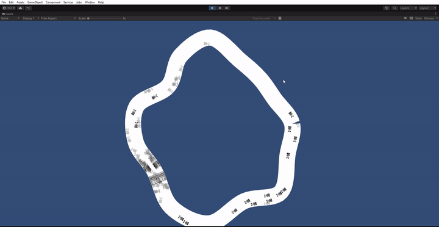

# Car Driver – Self-Driving Cars with Neuroevolution

A Unity 2D project where cars **learn to drive by themselves** on procedurally generated tracks. The **Neural Network** and **Genetic Algorithm** are both written from scratch in C#, without any ML libraries.

## Idea

No hand-coded driving rules: every car starts with a random "brain". Each generation, 100 cars race on the track. The ones that drive farthest and fastest pass their brains on to the next generation, with small mutations. Over time, the cars go from crashing into walls to completing full laps smoothly.

## How It Works

1. **Sense** – 5 raycast sensors (90° field of view) measure the distance to the walls, normalized to `[0, 1]`.
2. **Think** – The sensor values and the current speed feed a neural network (`6 → 6 → 2`, tanh).
3. **Act** – The network outputs **steering** and **acceleration** in `[-1, 1]` to a Rigidbody2D car with drift physics.
4. **Evolve** – When every car has crashed, timed out or finished a lap, each car is scored on checkpoints passed and lap time, and the next generation is bred.

## Tech Highlights

- **Neural Network from scratch** – layers, weights, biases and feed-forward; weights are encoded to and decoded from genes.
- **Generic Genetic Algorithm** – a reusable `GeneticAlgorithm<T>` / `DNA<T>` with elitism (top 5), tournament selection, uniform crossover and mutation.
- **Procedural Track Generation** – a random closed loop with smoothed curves, auto-generated EdgeCollider2D walls and a start line.
- **Checkpoint System** – tracks progress and lap time, and removes cars that get stuck.
- **Training Tools** – adjustable simulation speed, JSON save/load of trained generations, and debug gizmos with a stats UI.

## Getting Started

- Unity **2022.3.26f1**
- Open the project and play the main scene. The speed button accelerates training, and the dropdown loads a saved generation.

**Stack:** Unity · C# · Physics2D · LineRenderer · TextMeshPro
